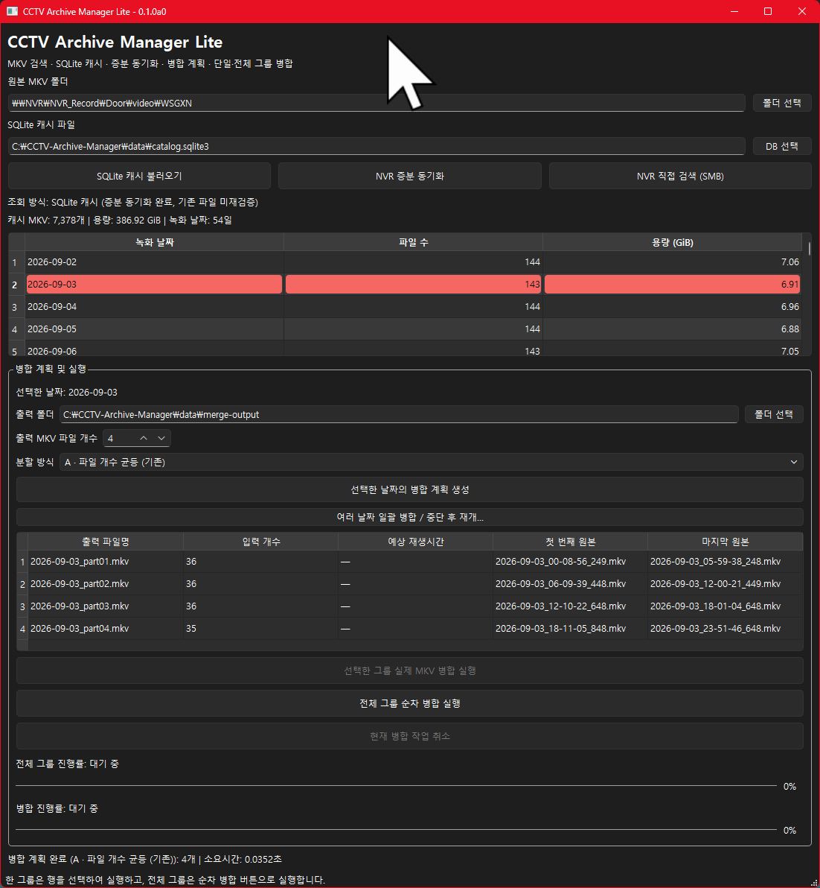
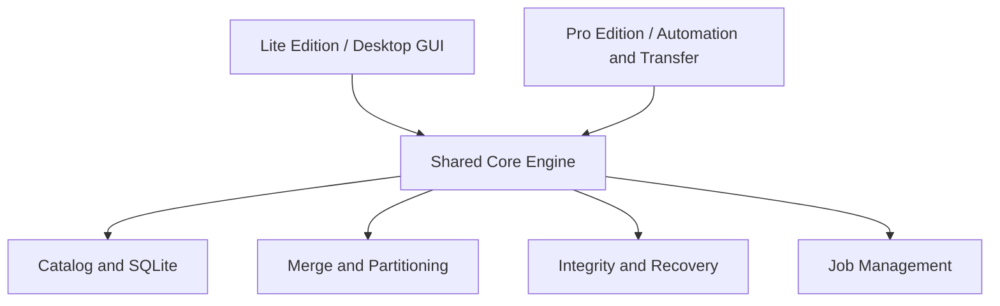

<h1 align="center">CCTV Archive Manager</h1>
<p align="center"><strong>Lite Edition · CCTV 영상 관리 및 아카이빙</strong><br>Recording Management &amp; Archiving</p>
<p align="center">
  
  
  
  
  
  
</p>
<p align="center">One Core, Two Editions — Lite &amp; Pro</p>

## 1. Overview | 프로젝트 소개

NVR 및 iSpy Agent DVR 등에서 생성된 MKV 녹화파일을 검색하고 날짜별로 정리하며, 재인코딩 없이 병합하는 Windows 데스크톱 프로그램입니다. 기존 NVR을 대체하지 않고 녹화가 완료된 파일의 관리와 장기 보관을 지원합니다.

A Windows desktop application for discovering, organizing and merging MKV recordings from NVR systems and software such as iSpy Agent DVR, without re-encoding. It complements existing recording systems rather than replacing them.

수천 개의 짧은 녹화파일을 다루는 환경에서 파일 검색, 네트워크 공유 폴더 조회, 이동식 저장장치에서의 탐색 및 장기 보관 부담을 줄이는 것이 개발 목적입니다.

The project aims to simplify navigation, network-share browsing and long-term storage of thousands of short recording segments, including archives on removable media.

## 2. Screenshot | 프로그램 실행 화면

<p align="center"></p>
<p align="center">실제 NVR 카탈로그 · Real NVR catalog<br><strong>7,378 MKV files · 386.92 GiB · 54 recording days</strong></p>

위 화면은 파일 개수 기반 병합 계획을 보여주는 개발 버전입니다. 전체 데이터의 병합 완료를 의미하지 않습니다.

The screenshot shows a file-count-based merge plan in the development build, not a completed merge of the entire dataset.

## 3. Key Features | 주요 기능

| 한국어 | English | 상태 / Status |
|---|---|---|
| MKV 검색 및 날짜·시간 분류 | MKV discovery and chronological cataloging | Implemented |
| 유연한 파일명 접두사 및 기존 규칙 호환 | Flexible filename prefixes and backward compatibility | Implemented — Part 5-1 |
| 단일 소스 폴더 및 접두사 충돌 검사 | Single-source folder and prefix conflict checks | Implemented — Part 5-1 |
| 다중 타임스탬프 형식 | Multiple timestamp formats | Planned — Part 5-2 |
| SQLite 캐시 및 증분 동기화 | SQLite caching and incremental synchronization | Implemented |
| SMB 원본 조회 | SMB source access | Implemented |
| 파일 개수 / 실제 재생시간 균등 분할 | File-count / duration-based partitioning | Implemented |
| FFprobe 재생시간 캐싱 | FFprobe duration caching | Implemented |
| 재인코딩 없는 MKV 병합 | MKV merging without re-encoding | Implemented |
| 날짜별 일괄 병합 및 미리보기 (최대 7일) | Multi-day batch planning and merging (up to 7 days) | Implemented |
| JSON 체크포인트 및 완료 그룹 재사용 | JSON checkpoints and completed-group reuse | Implemented |
| MKV 식별 및 SHA-256 검사 | MKV identification and SHA-256 verification | Implemented |
| 선택적 FFmpeg 전체 디코딩 | Optional full FFmpeg decoding | Implemented |
| 읽기 전용 진단 및 승인 기반 복구 | Read-only diagnostics and approved recovery | Implemented |
| SQLite 병합 작업 이력 및 원클릭 복구 | SQLite job history and one-click recovery | In progress — schema and state management implemented; integration pending |
| 수동 작업 대기열 | Manual job queue | Planned — Part 7 |

### 3.1. Supported Recording Filenames | 지원 파일명 규칙

현재는 Agent DVR 형식의 타임스탬프를 사용하며, 선택적 접두사를 지원합니다. / The current parser supports Agent DVR-style timestamps with an optional prefix.

```text
YYYY-MM-DD_HH-mm-ss_SSS.mkv
PREFIX_YYYY-MM-DD_HH-mm-ss_SSS.mkv
```

| 예시 / Example | 상태 / Status |
|---|---|
| `2026-11-25_19-43-05_859.mkv` | Supported |
| `4_2026-11-25_19-43-05_859.mkv` | Supported |
| `[CH1]C545D-Wide_2026-11-25_19-43-05_859.mkv` | Supported |
| `현관 카메라_2026-11-25_19-43-05_859.mkv` | Supported |
| `20261125-194305.mkv` | Planned |
| `2026_11_25_19_43_05_859.mkv` | Planned |
| `2026-11-25_19-43-05.mkv` | Not yet supported |
| `20261125-194305_CH1.mkv` | Not yet supported |

숫자, 영문, 한글, 공백, 대괄호 및 하이픈 등이 포함된 접두사를 허용하며 잘못된 날짜·시간은 거부합니다. `.mkv` 확장자는 대소문자를 구분하지 않습니다. 현재 날짜·시간 구조와 3자리 밀리초는 고정되어 있습니다.

Prefixes may contain numbers, letters, Korean characters, spaces, brackets and hyphens. Invalid dates and times are rejected. The `.mkv` extension is case-insensitive. The timestamp layout and three-digit milliseconds are currently mandatory.

병합 시 한 폴더가 하나의 카메라 소스라는 전제를 사용합니다. 서로 다른 폴더 또는 충돌하는 명시적 카메라 접두사는 거부합니다. 숫자 접두사와 접두사 없는 파일은 동일 폴더에서 공존할 수 있지만, 실제 카메라의 물리적 동일성을 증명하지는 않습니다. 사용자가 소스별로 폴더를 분리해야 합니다.

Merging assumes one camera source per folder. Mixed folders or conflicting explicit camera labels are rejected. Numeric IDs and unprefixed filenames may coexist in a folder but do not prove physical camera identity. Users must keep sources separated.

## 4. Editions & Architecture | 제품 구성 및 공통 엔진

**One Core, Two Editions**

Lite와 Pro는 카탈로그, 병합, 데이터 관리, 무결성 검사 및 장애 복구 엔진을 공유하도록 설계할 예정입니다. 제품별 코드를 복제하지 않고 공통 기능을 재사용하는 것이 목표입니다.

Both editions are intended to share cataloging, merging, persistence, integrity checking and recovery components, reducing duplicated maintenance and patches.



*목표 아키텍처이며 모듈 분리가 모두 완료된 것은 아닙니다. / Target architecture; modular separation is not yet complete.*

| 기능 / Feature | Lite | Pro (planned) |
|---|---|---|
| 수동 병합 및 무결성 검사 / Manual merging and integrity checks | Yes | Yes |
| 사용자 승인 복구 / User-approved recovery | Yes | Yes |
| 작업 이력 및 대기열 / Job history and queue | Planned | Planned |
| 기간 경과 자동 병합 / Age-based automatic merging | — | Planned |
| 무인 운영 및 예약 실행 / Unattended operation and scheduling | — | Planned |
| SMB, FTP, SFTP 자동 전송 / Automated remote transfer | — | Planned |
| Google Drive, YouTube 비공개 업로드 / Cloud backup and private uploads | — | Planned |
| Telegram, NVR, WebRTC API 연동 / Notifications and integrations | — | Planned |
| 웹 관리, Linux, Docker, Proxmox, ARM / Web management and server platforms | — | Planned |

Tailscale을 통한 원격 저장소 접근도 Pro의 검토 대상입니다. / Remote storage access over Tailscale is also planned for evaluation in Pro.

## 5. Development Status | 개발 현황

**Alpha 0.1.0a0 · Part 5-1 validated · 2026-11-27**

### Latest validation | 최신 검증 (Part 5-1)

| 검증 항목 / Validation | 결과 / Result |
|---|---|
| C500 파일명 인식 개선 / C500 filename recognition | 7,378/7,857 (93.90%) → 7,857/7,857 (100%) |
| C500 추가 인식 / Newly recognized C500 files | 479 |
| 신규 4채널 파일명 / Four-channel filenames | 63/63 |
| 전체 파일명 검증 / Total filename checks | 7,920 files |
| C500 조사 데이터 / C500 inventory | 427.39 GiB, 59 recording days |
| 카탈로그 및 병합 계획 / Catalog and merge planning | 52/52 PASS |
| 병합 실행 안전성 / Merge preparation safety | 27/27 PASS |
| 실제 MKV 병합 및 메타데이터 / Real merges and metadata checks | 14/14 PASS |
| 검사 대상 입력 해시 / Tested input SHA-256 | Unchanged |
| 전체 회귀 테스트 / Regression suite | 211 total: 210 passed, 1 skipped, 0 failed |
| 테스트 실행 시간 / Test runtime | 3.581 s |
| 제5-1부 코드 커밋 / Part 5-1 code commit | `332cb6e` |

실제 C500 8개 파일의 2분할 검사에서 A 방식의 Part 간 재생시간 편차는 1,241.288초, B 방식은 559.482초로 약 54.93% 감소했습니다. 이는 해당 샘플의 계획 기준 실측 재생시간을 이용한 결과이며 모든 데이터에서 같은 개선율을 보장하지 않습니다.

In the real eight-file C500 two-part test, the planned duration spread fell from 1,241.288 seconds (Plan A) to 559.482 seconds (Plan B), approximately 54.93%. This is sample-specific and not a universal performance guarantee.

14개 병합 결과는 메타데이터 검사 기준입니다. 결과물 전체 디코딩 및 SEI/DTS 진단의 상세 원인 분석은 보류했으며 기존 무결성 정책은 변경하지 않았습니다. 전체 7,920개 파일의 실제 병합을 수행한 것은 아닙니다.

The 14 successful merges were checked at metadata level. Full decoding of these outputs and detailed SEI/DTS investigation remain deferred; the existing integrity policy is unchanged. The 7,920-file inventory was not merged in full.

### Historical validation | 이전 검증 (Part 5 · 2026-11-25)

| 검증 항목 / Validation | 결과 / Result |
|---|---|
| 최종 단위 테스트 / Final unit tests | 184 passed, 0 failed, 0 skipped |
| 실행 시간 / Test runtime | 1.728 s |
| 실제 재생시간 분석 / Real recording duration analysis | 143 MKV files |
| 최초 분석 / Initial analysis | 26.351 s |
| 캐시 재사용 / Cached analysis | 2.376 s |
| 실제 NVR 소규모 병합·재개 / Real NVR merge and resume | 4 source files, PASS |
| 실제 mkvmerge 강제 종료 / Forced mkvmerge termination | PASS |
| GUI 복구 및 최종 해시 대조 / GUI recovery and final hash comparison | 2 synthetic outputs, PASS |
| 제5부 최종 코드 커밋 / Part 5 code commit | `0a17248` |

테스트 결과는 당시 Windows 환경의 실측값입니다. 전체 7,378개 파일 장시간 병합, 실제 전원 차단 및 장기 무인 운영 검증은 아직 수행하지 않았습니다. 복구는 현재 사용자 승인 방식이며 중단된 그룹을 처음부터 다시 병합합니다.

These are measured results from the Windows test environment. Full-dataset merging, physical power-loss testing and long-term unattended operation remain unverified. Recovery currently requires user approval and restarts the interrupted group from the beginning.

## 6. Development Roadmap | 개발 로드맵

### Season 1 — Lite v1.0.0

| Part | 개발 내용 / Milestone | Status |
|---|---|---|
| 1–4 | 초기 개발, 카탈로그, 병합 GUI, 증분 동기화 / Foundation, catalog, merge GUI and incremental sync | Completed |
| 5 | 재생시간 분할 및 장애 복구 / Duration planning and crash recovery | Completed |
| 5-1 | 파일명 접두사 지원 및 소스 격리 / Filename prefixes and source isolation | Completed |
| 5-2 | 다중 파일명 패턴 및 타임스탬프 형식 / Multi-format filename parser | Next |
| 5-3 | 사용자 정의 파일명 규칙 및 미리보기 / Custom filename templates and preview | Proposed |
| 6 | SQLite 작업 관리 및 원클릭 복구 / Job management and one-click recovery | In progress — paused for parser expansion |
| 7 | 수동 대기열 및 백그라운드 병합 / Manual queue and background merging | Planned |
| 8 | 대규모 운영 검증 및 최적화 / Large-scale testing and optimization | Planned |
| 9 | GUI 개선 및 Windows 패키징 / UX and Windows packaging | Planned |
| 10 | Lite v1.0.0 정식 출시 / Stable release | Planned |

### Season 2 — Pro v1.0.0 (tentative / 잠정 계획)

| Part | 개발 내용 / Milestone |
|---|---|
| 11 | 공통 엔진 확장 / Shared-core extension |
| 12 | 기간 기반 아카이빙 / Age-based archiving policies |
| 13 | 스케줄러 및 서비스 / Scheduler and background services |
| 14 | SMB, FTP, SFTP 전송 / Remote transfers |
| 15 | Google Drive 백업 / Cloud archiving |
| 16 | YouTube 비공개 업로드 / Private video uploads |
| 17 | 알림 및 API 연동 / Notifications and integrations |
| 18 | 다중 NVR 및 웹 관리 / Multi-NVR and web management |
| 19 | 서버 플랫폼 검증 / Server platform validation |
| 20 | Pro 정식 출시 / Pro stable release |

회차 및 기능 범위는 개발·검증 결과에 따라 변경될 수 있습니다. / Milestones and scope may change as development progresses.

## 7. Getting Started | 개발 환경 실행

현재는 개발 버전입니다. Windows 설치형 패키지는 향후 제공할 계획입니다. / This is a development build; a Windows installer is planned.

기존 Python 3.14 가상환경 및 PySide6, FFmpeg/FFprobe, MKVToolNix가 준비된 저장소에서 실행합니다. / Run from the repository with the existing Python 3.14 virtual environment, PySide6, FFmpeg/FFprobe and MKVToolNix installed.

```powershell
$env:PYTHONPATH = (Resolve-Path '.\src').Path
$env:FFMPEG_EXE = (Get-Command ffmpeg -ErrorAction Stop).Source
$env:MKVMERGE_EXE = 'C:\Program Files\MKVToolNix\mkvmerge.exe'
.\.venv\Scripts\python.exe -m cctv_archive_manager.gui
```

도구 설치 경로는 환경에 맞게 조정합니다. / Adjust executable paths to your environment.

### Tests | 테스트

```powershell
.\.venv\Scripts\python.exe -W error::ResourceWarning -m unittest discover -s tests -v
```

Windows 심볼릭 링크 생성 권한이 없으면 해당 보안 테스트가 건너뛰어질 수 있습니다. 최신 회귀 테스트는 211개 중 210개 통과, 1개 건너뜀입니다. 제5부 당시 관리자 권한 환경에서는 184개 모두 통과했습니다. / The symlink test may be skipped without appropriate Windows permissions. The latest suite recorded 210 passes and 1 skip out of 211 tests; all 184 historical Part 5 tests passed in an elevated session.

## 8. Technology Stack | 기술 스택

| 구성 / Component | Technology | Status |
|---|---|---|
| 언어 / Language | Python 3.14 | Current |
| GUI | PySide6 | Current |
| 데이터베이스 / Database | SQLite | Current |
| 병합 / Merge | MKVToolNix | Current |
| 분석 및 검증 / Analysis and validation | FFprobe, FFmpeg | Current |
| 버전 관리 / Version control | Git, GitHub | Current |
| Pro 웹 API / Web API | FastAPI | Candidate |
| Pro 전송 / Transfer | rclone | Candidate |

## 9. Data Safety | 데이터 보호 원칙

| 한국어 | English |
|---|---|
| 원본 CCTV는 읽기 전용으로 취급 | Treat source recordings as read-only |
| 병합 결과는 별도 출력 폴더에 저장 | Write outputs to a separate directory |
| 원본 자동 이동 및 삭제 금지 | Do not automatically move or delete originals |
| 서로 다른 소스 폴더 및 충돌 접두사 병합 거부 | Reject mixed source folders and conflicting prefixes |
| 기존 출력 덮어쓰기 방지 | Prevent unintended output overwrites |
| 완료 그룹의 무결성 확인 | Verify completed outputs before reuse |
| 미완료 영상 및 잠금은 승인 후 별도 보존 | Preserve incomplete artifacts after approved recovery |
| 자동 삭제는 별도 안전 검증 후 검토 | Evaluate automatic cleanup only after separate safety testing |

## 10. Development Log | 개발 기록

개발 과정과 검증 결과는 GitHub 및 네이버 블로그 개발일지에 기록합니다. / Development progress and validation results are documented on GitHub and in the Korean development blog series.

[GitHub Repository](https://github.com/GinGer-JSK/CCTV-Archive-Manager) · [Part 5 code commit](https://github.com/GinGer-JSK/CCTV-Archive-Manager/commit/0a17248404f908ff18b00846692cf1e466eaf287) · [Part 5-1 code commit](https://github.com/GinGer-JSK/CCTV-Archive-Manager/commit/332cb6e) · [CHANGELOG](CHANGELOG.md)

## 11. License | 라이선스

프로젝트 라이선스는 정식 배포 전에 확정할 예정입니다. 외부 도구는 각자의 라이선스를 따릅니다.

The project license is to be finalized before formal distribution. Third-party tools remain subject to their respective licenses.
